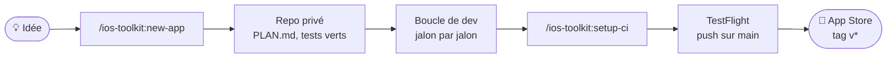
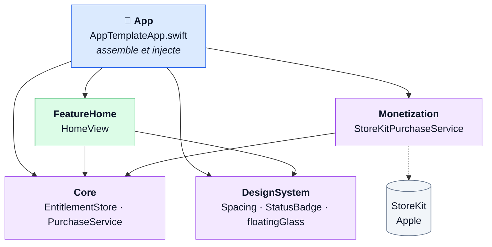
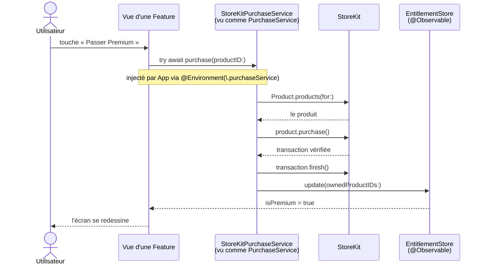
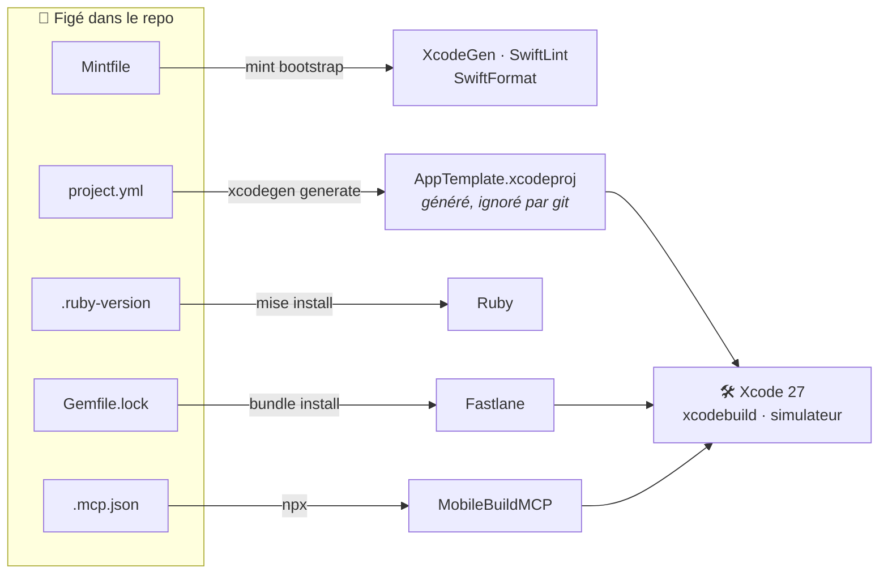
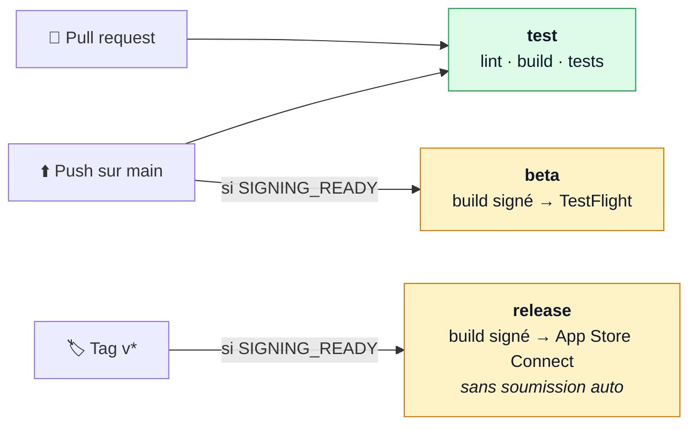
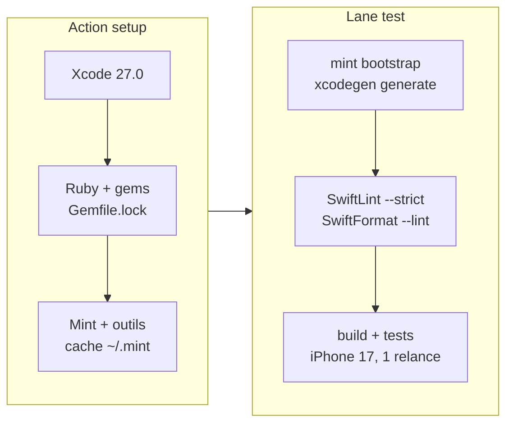

# ios-template

Squelette d'app iOS **monétisée**, prêt à copier : un écran SwiftUI, un abonnement premium via StoreKit, des tests, et une CI qui va jusqu'à TestFlight et l'App Store.


Ce repo est un **template GitHub** : on ne développe pas d'app dedans. Chaque nouvelle app en est une copie, créée et renommée par le plugin Claude Code [ios-toolkit](https://github.com/j0hanj0han/ios-toolkit).

---

## Sommaire

- [Le cycle de vie d'une app](#le-cycle-de-vie-dune-app)
- [L'arborescence](#larborescence)
- [Les modules](#les-modules)
- [Le parcours d'un achat](#le-parcours-dun-achat)
- [Les outils](#les-outils)
- [Les tests](#les-tests)
- [La CI](#la-ci)
- [Les commandes](#les-commandes)
- [Les règles du projet](#les-règles-du-projet)

---

## Le cycle de vie d'une app



1. **`/ios-toolkit:new-app <Nom> [idée]`** crée un repo privé depuis ce template, renomme `AppTemplate` et `com.example.apptemplate`, écrit `PLAN.md` à partir de l'idée, vérifie que `fastlane test` est vert et pousse le premier commit.
2. **La boucle de dev**, décrite dans [`CLAUDE.md`](CLAUDE.md) : lire « État courant » dans `PLAN.md`, coder le jalon, build et tests, capture du simulateur si c'est de l'UI, corriger jusqu'au vert, mettre `PLAN.md` à jour, commit.
3. **`/ios-toolkit:setup-ci`** branche la signature (match) et App Store Connect. Ensuite, chaque push sur `main` envoie un build sur TestFlight.

---

## L'arborescence

```
ios-template/
├── App/                      l'app : point d'entrée et assemblage, rien d'autre
│   ├── AppTemplateApp.swift    @main — crée les services, les injecte, affiche HomeView
│   ├── Assets.xcassets/        icône, couleur d'accent
│   └── PrivacyInfo.xcprivacy   manifeste de confidentialité (exigé par l'App Store)
├── AppTests/                 tests qui ont besoin de l'app hôte
│   └── StoreKitPurchaseServiceTests.swift
├── Packages/                 un Swift Package local par module
│   ├── Core/                   modèles et contrats — ne dépend de rien
│   ├── DesignSystem/           tokens, composants, wrapper Liquid Glass
│   ├── Monetization/           StoreKit — le seul module qui le connaît
│   │   └── StoreKit/Products.storekit   faux catalogue App Store
│   └── FeatureHome/            un écran = une Feature (+ son CLAUDE.md)
├── docs/architecture.md      le « pourquoi » des choix, avec exemples
├── project.yml               description du projet → XcodeGen génère le .xcodeproj
├── Mintfile                  versions de XcodeGen, SwiftLint, SwiftFormat
├── Gemfile · Gemfile.lock    version de Fastlane
├── .ruby-version             version de Ruby
├── .swiftlint.yml            règles de qualité
├── .swiftformat              règles de mise en forme
├── fastlane/                 lanes test, beta, release
├── .github/                  CI : workflow + action de setup
├── .mcp.json                 MobileBuildMCP (build, tests, simulateur pour Claude)
└── CLAUDE.md                 les règles du projet
```

Chaque package suit le même schéma : `Package.swift`, `Sources/<Nom>/`, `Tests/<Nom>Tests/`.

> Le `.xcodeproj` n'est **pas** versionné : XcodeGen le régénère depuis `project.yml`. On évite ainsi les conflits git illisibles dans ce gros fichier.

---

## Les modules



| Module | Contenu | Dépend de |
|---|---|---|
| **Core** | `EntitlementStore` (l'utilisateur est-il premium ?), le protocole `PurchaseService`, la clé d'environnement `\.purchaseService` | rien |
| **DesignSystem** | `Spacing`, `Radius`, `StatusBadge`, et `floatingGlass` / `GlassGroup`, seul accès autorisé à Liquid Glass | SwiftUI |
| **Monetization** | `StoreKitPurchaseService`, qui implémente `PurchaseService` avec StoreKit 2, et `Products.storekit` | Core |
| **FeatureHome** | `HomeView` et `AccessStatus`, sa logique pure | Core, DesignSystem |
| **App** | crée `EntitlementStore` et `StoreKitPurchaseService`, les injecte avec `.environment(...)` | tout |

**Les deux règles qui tiennent l'architecture :**

- Une Feature dépend de Core et DesignSystem, **jamais** d'une autre Feature ni de Monetization. Elle appelle le protocole `PurchaseService` sans savoir que StoreKit existe ; c'est `App` qui fournit la vraie implémentation.
- Pattern **MV** : pas de ViewModel par défaut. La vue lit directement les modèles injectés :

```swift
public struct HomeView: View {
    @Environment(EntitlementStore.self) private var entitlements

    public var body: some View {
        StatusBadge(entitlements.isPremium ? "Premium" : "Gratuit", systemImage: "crown.fill")
    }
}
```

Un `@Observable` propre à l'écran ne s'ajoute que s'il y a de la logique asynchrone ou de la validation. Détails et exemples : [`docs/architecture.md`](docs/architecture.md).

---

## Le parcours d'un achat



Au lancement, `App` appelle aussi `purchases.start()` : le service écoute `Transaction.updates` (renouvellements, achats faits ailleurs) et garde `EntitlementStore` à jour.

En développement, StoreKit ne parle pas au vrai App Store : il lit [`Products.storekit`](Packages/Monetization/StoreKit/Products.storekit), branché sur l'action Run du scheme. On achète sans compte sandbox ni carte bancaire.

---

## Les outils



| Outil | Version | Figée dans | Rôle |
|---|---|---|---|
| Xcode / Swift | 27 / 6.4 | CI : `.github/actions/setup` | compilateur, SDK iOS, simulateur ; concurrence stricte complète |
| Swift Package Manager | — | `Packages/*/Package.swift` | les modules locaux |
| [XcodeGen](https://github.com/yonaskolb/XcodeGen) | 2.46.0 | `Mintfile` | génère le `.xcodeproj` depuis `project.yml` |
| [SwiftLint](https://github.com/realm/SwiftLint) | 0.65.1 | `Mintfile` | qualité du code, en mode strict ; interdit `AnyView` |
| [SwiftFormat](https://github.com/nicklockwood/SwiftFormat) | 0.64.4 | `Mintfile` | mise en forme automatique |
| [Mint](https://github.com/yonaskolb/Mint) | — | — | installe les trois outils ci-dessus aux versions du `Mintfile` |
| Ruby | 4.0.9 | `.ruby-version` | fait tourner Fastlane (installé via [mise](https://mise.jdx.dev)) |
| [Fastlane](https://fastlane.tools) | 2.241.2 | `Gemfile.lock` | les lanes `test`, `beta`, `release` |
| match | (Fastlane) | `fastlane/Matchfile` | certificats de signature, chiffrés dans un repo git privé |
| Swift Testing | (Xcode) | — | `@Test`, `#expect` |
| StoreKitTest | (Xcode) | `Products.storekit` | faux App Store pour les tests d'achat |
| [MobileBuildMCP](https://github.com/getsentry/MobileBuildMCP) | 2.7.1 | `.mcp.json` | permet à Claude de builder, tester et faire des captures du simulateur |

Règle du projet : **on ne monte jamais une version sans le décider explicitement**.

<details>
<summary><b>Équivalents Python</b>, pour s'y retrouver</summary>

| Swift / iOS | Python |
|---|---|
| `Package.swift` + packages locaux | `pyproject.toml` + `pip install -e ../core` |
| `Mintfile` | `pipx` avec versions épinglées |
| `Gemfile.lock` + Bundler, `.ruby-version` + mise | `requirements.lock` + pip, `.python-version` + pyenv |
| SwiftLint / SwiftFormat | ruff / black |
| Swift Testing (`@Test`, `#expect`) | pytest (`def test_…`, `assert`) |
| Lanes Fastlane | cibles d'un Makefile, sessions nox |
| `protocol` + `@Environment` | `typing.Protocol` + `Depends` de FastAPI |
| `@Observable` | un objet réactif : les vues qui le lisent se redessinent |
| StoreKitTest + `Products.storekit` | `moto` ou `responses` : un faux service |

</details>

---

## Les tests

| | Tests unitaires | Test d'intégration |
|---|---|---|
| **Où** | `Packages/*/Tests/` | `AppTests/` |
| **Quoi** | logique pure : `EntitlementStore`, `OwnedProducts`, `AccessStatus` | un vrai achat de bout en bout via `SKTestSession` |
| **Dépendances** | aucune | StoreKit, l'app hôte, un simulateur |
| **Durée** | quelques millisecondes | de 0,2 s à une minute |

Les deux tournent dans le scheme `AppTemplate`, donc dans `fastlane test` et en CI.

Pourquoi le test d'achat vit dans `AppTests/` : StoreKit n'achète que pour une app installée, avec un bundle id. L'app sert donc d'« hôte » au test ; dans ce cas, elle ne démarre pas StoreKit elle-même, pour laisser le test installer sa configuration.

> **Simulateur neuf :** sur un simulateur jamais démarré, ce qui est toujours le cas en CI, le premier achat attend une connexion Apple ID que personne ne fait. Le test a une limite d'une minute, et Fastlane le relance une fois dans un nouveau process, où il passe. Un vrai bug échoue aux deux passages. Détails dans [`docs/architecture.md`](docs/architecture.md#monétisation).

---

## La CI

`.github/workflows/ci.yml` n'appelle que des lanes Fastlane : aucune logique n'est dupliquée dans le YAML.



Chaque job commence par l'action `.github/actions/setup`, puis lance sa lane du `fastlane/Fastfile`. Pour le job `test` :



- **Runner** : image GitHub `xcode-27`. La CI fige Xcode 27.0, aligné sur le seul simulateur iPhone de l'image (iOS 27.0).
- **Cache mint** : sauvé dès l'installation des outils, même si les tests échouent ensuite. Le job `test` tourne aussi sur `main`, pour que toutes les PR profitent de son cache. Sans cache, compiler les outils prend environ 15 minutes.
- **Signature** : `beta` et `release` utilisent match en lecture seule et une clé API App Store Connect. Tout se configure avec `/ios-toolkit:setup-ci` : variables et secrets GitHub, jamais de secret dans le repo.

---

## Les commandes

Installer les outils et générer le projet :

```bash
mint bootstrap && mint run xcodegen generate
```

Ouvrir le projet dans Xcode :

```bash
open AppTemplate.xcodeproj
```

Lancer exactement ce que fait la CI (génération, lint, format, build, tests) :

```bash
LANG=en_US.UTF-8 LC_ALL=en_US.UTF-8 bundle exec fastlane test
```

Fastlane a besoin d'une locale UTF-8 : sans elle, il affiche un trompeur « xcrun simctl not working ».

Avec Claude Code, le build, les tests et le simulateur passent en priorité par **MobileBuildMCP** (déclaré dans [`.mcp.json`](.mcp.json)).

---

## Les règles du projet

**SwiftUI**
- Pas d'`AnyView` : SwiftLint le bloque.
- Des `body` courts : on extrait des sous-vues dès que ça s'allonge.
- La logique non triviale sort de la vue, dans un type pur testé avec Swift Testing.

**Liquid Glass** (iOS 26)
- Les composants système (`NavigationStack`, `TabView`, `.toolbar`, sheets) ont déjà le verre : pas de fond custom sur les barres.
- Un effet custom passe uniquement par `DesignSystem` : `floatingGlass`, et `GlassGroup` pour regrouper plusieurs éléments. Jamais de verre sur du verre.
- Vérifier la lisibilité avec « Réduire la transparence » activé.

**Terminé, ça veut dire**
- compile sans warning (les warnings sont des erreurs) ;
- tests verts ;
- SwiftLint et SwiftFormat propres ;
- `PLAN.md` à jour, dans chaque app.

**Interdits**
- Aucun secret, certificat ou clé dans le repo : `.gitignore` bloque `*.p8`, `*.p12`, `*.mobileprovision`, `.env`.
- Le `.xcodeproj` ne se versionne pas.

---

## Pour aller plus loin

| Fichier | Contenu |
|---|---|
| [`CLAUDE.md`](CLAUDE.md) | règles complètes, stack, boucle de dev, CI |
| [`docs/architecture.md`](docs/architecture.md) | pattern MV, injection, appeler un service depuis une Feature, monétisation, Liquid Glass |
| [`Packages/FeatureHome/CLAUDE.md`](Packages/FeatureHome/CLAUDE.md) | les règles d'un module Feature |
| [ios-toolkit](https://github.com/j0hanj0han/ios-toolkit) | les skills `/new-app` et `/setup-ci` |
